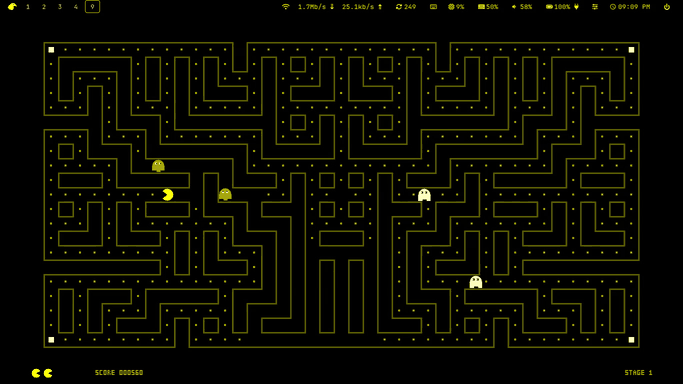
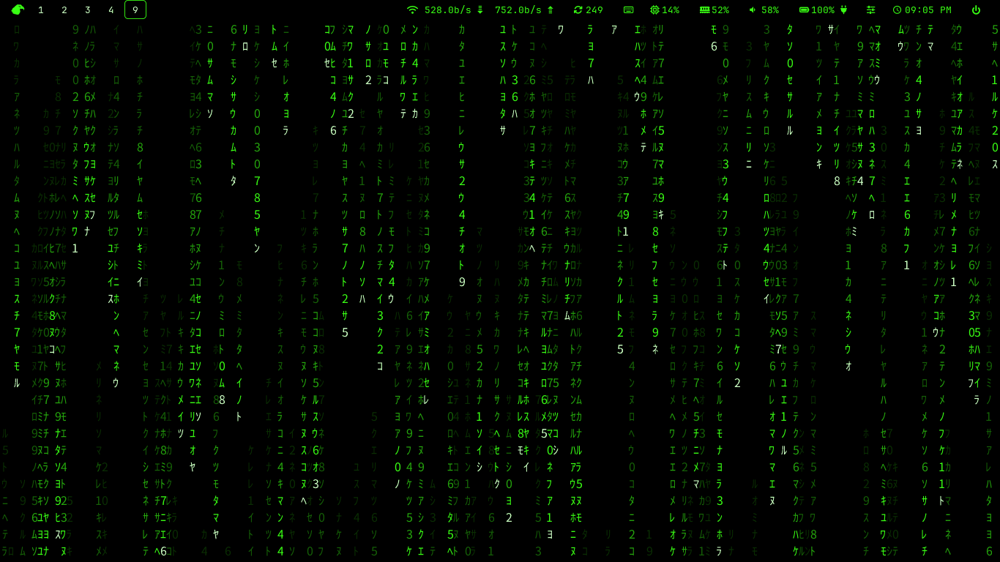
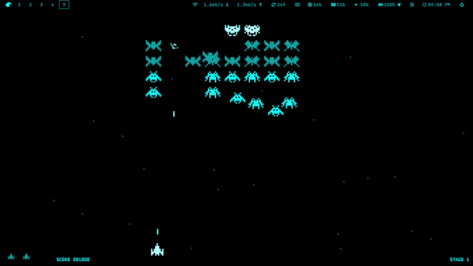
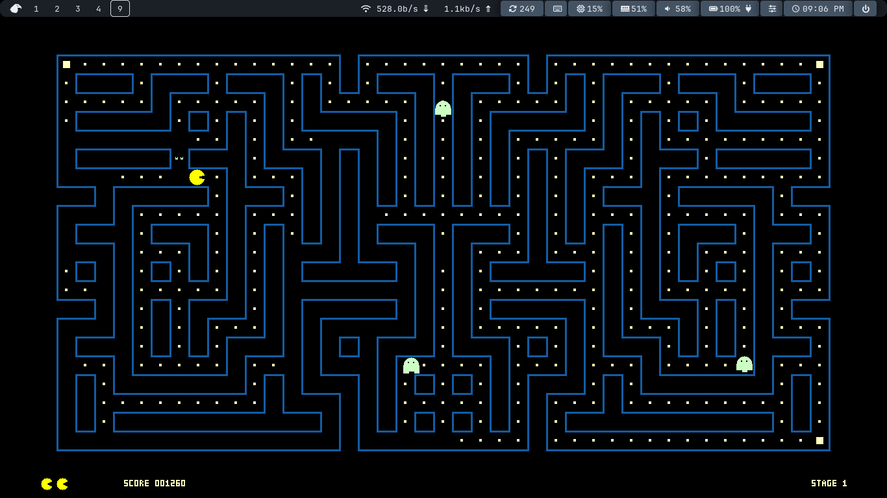
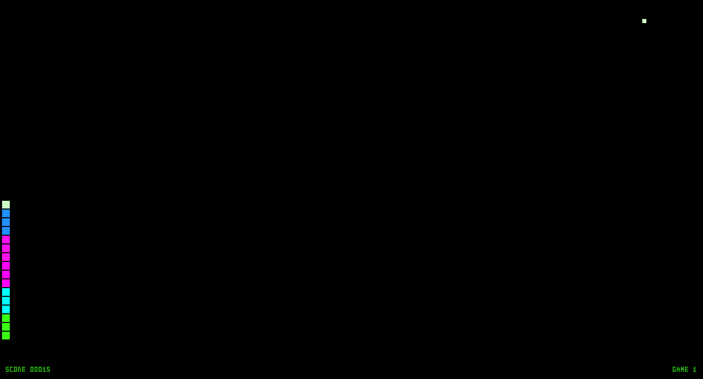
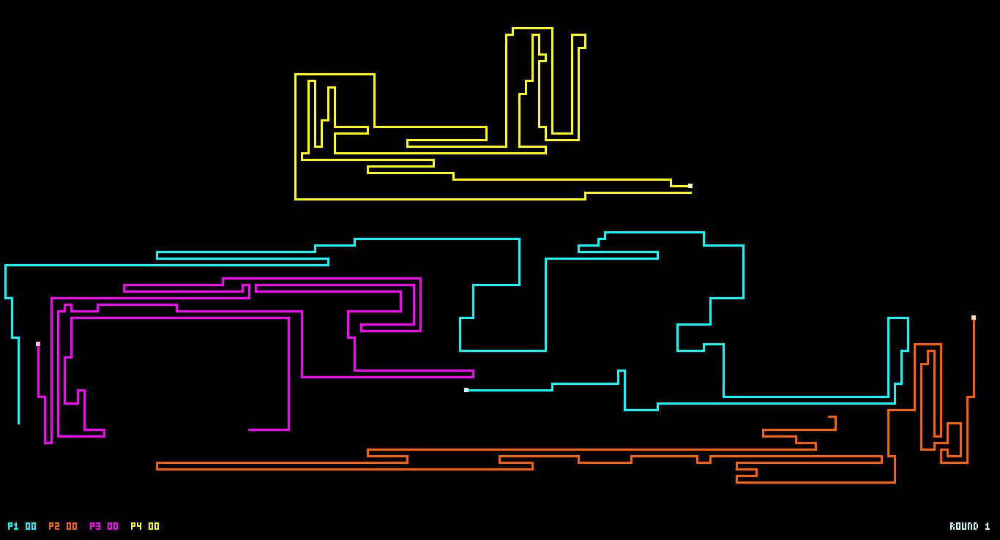
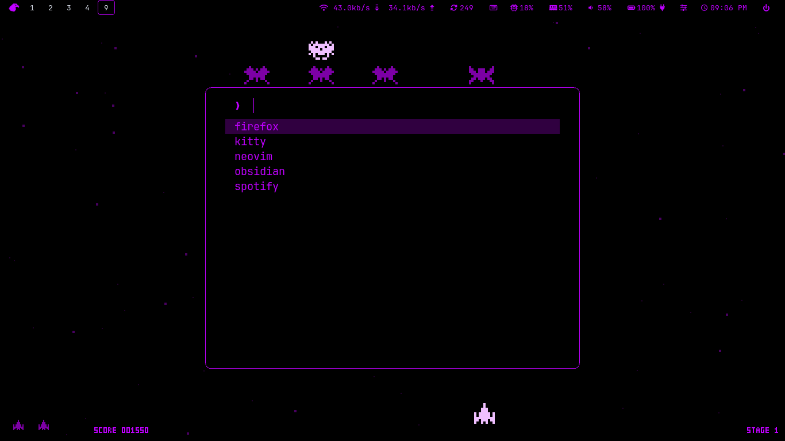

# matrix-wayland

Fondos animados para Wayland (lluvia Matrix, un Galaga o un Pac-Man que se juegan solos), en negro y con el
color que elijas. Cliente nativo en Rust que usa
`wlr-layer-shell` (capa `background`) y pinta por CPU con `wl_shm`: sin GPU, sin
terminal y sin XWayland.



## Escenas

El fondo es una **escena** (`--scene`), todas en negro y con el color que elijas (`-c`):

- **`matrix`** (por defecto): lluvia de caracteres.

  

- **`galaga`**: un shoot'em up inspirado en Galaga que **se juega solo**. Sprites propios (pixel art),
  formación de enemigos con entradas en curva y picados, y una IA que apunta, dispara y esquiva
  (con tiempo de reacción, así que a veces pierde y la partida se reinicia sola). Tres tipos de
  enemigo y la nave en el color elegido; con `-c rainbow`, un color distinto por tipo.
  `--hud` muestra puntuación, nivel y vidas abajo del todo.

  

- **`pacman`**: un Pac-Man inspirado que **se juega solo** en un laberinto **generado
  proceduralmente** (simétrico, conexo y sin callejones sin salida), adaptado al tamaño de la
  pantalla y distinto en cada nivel. Cuatro fantasmas con personalidades (persecución, emboscada
  y dos que se retiran a su esquina), pastillas de poder y una IA que busca puntos, huye de los
  fantasmas, va a por las pastillas de poder cuando se ve acorralada y persigue fantasmas
  asustados. Con `-c rainbow` usa los colores clásicos (laberinto azul, Pac-Man amarillo).
  `--hud` muestra puntuación, nivel y vidas; `--scale N` fija el tamaño de casilla en píxeles.

  
- **`snake`**: cinco serpientes que **se juegan solas**, cada una en su carril y con su propia comida,
  siguiendo un ciclo hamiltoniano (nunca mueren) y tomando atajos seguros. Cada una crece hasta llenar el
  75 % de su carril y reinicia por separado, así la pantalla se va llenando por completo. Con `rainbow`,
  cada serpiente tiene su color.

  

- **`tron`**: motos de luz que se pelean solas. Cada una deja una estela de neón y esquiva eligiendo el
  giro con más espacio libre; gana la última en pie (con `rainbow`, cuatro motos de colores).

  

- **`equalizer`**: analizador de espectro con barras de LED rectangulares, como los ecualizadores de las
  cadenas de música, con caída suave y marcador de pico. **Reacciona a lo que suena**: `parec` capta el
  monitor de la salida por defecto (PipeWire o PulseAudio), una FFT propia reparte el espectro en barras
  logarítmicas (45 Hz – 14 kHz) y la ganancia se ajusta sola. Sin audio, las barras caen a cero. No añade
  dependencias de compilación, pero necesita `parec` (paquete `pipewire-pulse` / `pulseaudio-utils`);
  `--simulate` (o su ausencia) usa una pista simulada con bombo, caja y hi-hats. La captura se marca
  como monitor, así que el módulo `privacy` de waybar no muestra el icono de micrófono. Con `rainbow`,
  verde → amarillo → rojo según la altura. `--scale N` fija el alto base del LED en píxeles (el ancho es
  el doble).

## Uso

```
matrix-wayland start -c cyan                 # arranca en segundo plano (start es opcional)
matrix-wayland start --scene galaga -c yellow --hud
matrix-wayland restart -c purple             # cambia de color y mantiene la escena
matrix-wayland status
matrix-wayland stop                          # parada limpia (SIGTERM), sin kill
matrix-wayland start --foreground            # primer plano, para depurar
```

Opciones: `-c` color (`green cyan magenta pink blue purple orange yellow red`, `#rrggbb` o
`rainbow`), `--scene matrix|galaga|pacman|snake|tron|equalizer`, `--fps N` (matrix 15, el resto 30), `-s` caracteres
(`mixed katakana binary digits hex`, solo matrix), `--size PX` y `--font RUTA` (solo matrix),
`--scale N` (galaga: píxeles por píxel de sprite; pacman, snake y tron: píxeles por casilla; equalizer: tamaño del LED; por defecto según la pantalla), `--hud`,
`--simulate` (equalizer), `--waybar` y `--fuzzel` (ver abajo).

**Las opciones se recuerdan entre arranques** (`~/.local/state/matrix-wayland/options`): lo que
escribas gana sobre lo recordado. `--no-waybar`, `--no-fuzzel` y `--no-hud` apagan una bandera, y
`--reset` olvida todo y vuelve a los valores por defecto.

### Solo los colores, sin escena

`stop` restaura los colores de waybar y fuzzel. Para apagar la escena y **dejarlos puestos**:

```
matrix-wayland stop --keep-theme      # apaga la escena, waybar y fuzzel conservan el color
matrix-wayland theme                  # reaplica lo recordado (p. ej. tras reiniciar el equipo)
matrix-wayland theme -c cyan          # cambia el color sin ninguna escena
matrix-wayland theme --off            # restaura los colores originales
```

`theme` usa las banderas recordadas (`--waybar`/`--fuzzel`); si hay una escena en marcha, se niega
(usa `restart -c COLOR`). Para que el color aparezca al iniciar sesión sin lanzar la escena, pon
`exec matrix-wayland theme` en tu configuración de sway.

## Color de waybar (`--waybar`, opcional)

En todas las capturas, la barra de arriba sigue el color del fondo (texto e iconos en el color
elegido sobre negro).

Con `--waybar`, matrix-wayland escribe en `~/.config/waybar/matrix-colors.css` las variables
`matrix_fg` (texto e iconos = el color elegido), `matrix_bar_bg` y `matrix_mod_bg` (negro),
`matrix_mod_hover` (el color al 25 %) y `matrix_accent`, y manda `SIGUSR2` a waybar para
recargar el estilo. Al parar, el fichero queda vacío y vuelven tus colores por defecto.
Con `-c rainbow`, waybar y fuzzel también van en modo rainbow: en waybar cada módulo y cada botón de
workspace lleva un neón distinto, alternados (cian, magenta, amarillo, verde...), con fondos negros y
fuzzel con un neón por elemento. Esto asume los ids de módulo del `style.css` de ejemplo de abajo
(`#cpu`, `#clock`, `#workspaces button`...).

Pon esto al principio de tu `style.css` y usa las variables en lugar de colores fijos:

```css
/* valores por defecto cuando matrix-wayland no corre */
@define-color matrix_fg #eceff4;
@define-color matrix_bar_bg rgba(46,52,64,0.6);
@define-color matrix_mod_bg rgba(129,161,193,0.4);
@define-color matrix_mod_hover rgba(129,161,193,0.8);
@import "matrix-colors.css";           /* el fichero debe existir; puede estar vacío */

#waybar { color: @matrix_fg; background-color: @matrix_bar_bg; }
#clock, #cpu, #memory { background: @matrix_mod_bg; }
#clock:hover, #cpu:hover, #memory:hover { background: @matrix_mod_hover; }
```

Crea antes el fichero vacío: `touch ~/.config/waybar/matrix-colors.css`. Después:
`matrix-wayland start -c yellow --waybar`. La recarga reinicia los módulos de waybar un
instante, así que solo ocurre al iniciar, reiniciar y parar.

## Color de fuzzel (`--fuzzel`, opcional)

Con `--fuzzel` escribe `~/.config/fuzzel/matrix-colors.ini` (`[colors]`: texto, borde y selección en
el color elegido, fondo negro). Fuzzel lee su configuración al abrirse, así que no hay que recargar
nada. Al parar, el fichero queda vacío y vuelven tus colores.



Fuzzel solo admite `include` en `[main]` y gana el último valor definido, así que tus colores deben
ir en un fichero aparte, incluido antes que el de matrix-wayland (el fichero debe existir):

```ini
# ~/.config/fuzzel/fuzzel.ini (arriba del todo, antes de cualquier [seccion])
include=~/.config/fuzzel/colors-default.ini   # tu bloque [colors] de siempre
include=~/.config/fuzzel/matrix-colors.ini
```

Se pueden combinar: `matrix-wayland start -c yellow --waybar --fuzzel`.

## Compilar e instalar

```
cargo build --release
install -m755 target/release/matrix-wayland ~/.local/bin/
```

Necesita un compositor con `wlr-layer-shell` (sway, Hyprland, river...) y una fuente con
katakana de media anchura. Por defecto `/usr/share/fonts/noto-cjk/NotoSansCJK-Regular.ttc`
(cámbiala con `--font`).

## Consumo medido

Escena matrix en distintas implementaciones (y galaga al final), pantalla 1366x768 (sway). CPU en régimen estable:

| Implementación | CPU |
|---|---|
| Python en `kitten panel` (25 FPS) | ~13 % solo el script, más kitty pintando |
| Rust en terminal con `kitten panel` (15 FPS) | ~17 % (kitty ~16 % + script ~1 %) |
| **matrix-wayland, escena matrix (wl_shm, 15 FPS)** | **~4,3 %**, ~13 MB de RAM |
| **matrix-wayland, escena galaga (wl_shm, 30 FPS)** | **~6,6 %**, ~11 MB de RAM |
| **matrix-wayland, escena pacman (wl_shm, 30 FPS)** | **~7,9 %**, ~16 MB de RAM |
| **matrix-wayland, escenas snake / tron (wl_shm, 30 FPS)** | **~6-7 %**, ~12 MB de RAM |

Las cifras de Python/Go/Rust en terminal se midieron con un pty de 200x50, y la de
matrix-wayland con `/proc/<pid>/stat`; no son comparables al 100 %.

## Licencia

GPL-3.0-or-later. Ver [LICENSE](LICENSE).

## Limitaciones

- Una sola superficie: no gestiona varios monitores a propósito ni escalado HiDPI.
- El arranque tarda unos segundos de CPU al rasterizar la fuente CJK (después se libera).
- Si falla tras los primeros 1,5 s, `start` ya habrá dicho «iniciado»; usa `--foreground`.
